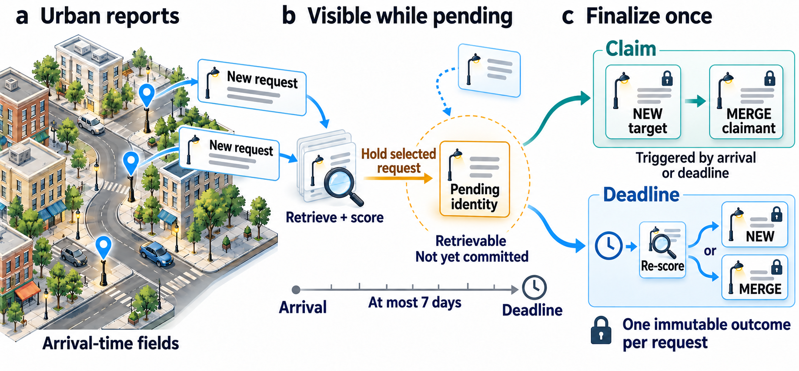
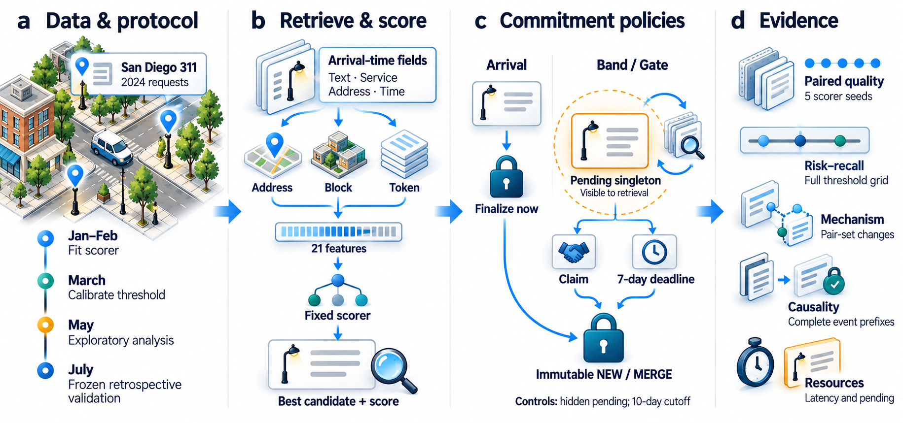

# What Does Deferral Buy?

Research artifact for *What Does Deferral Buy? Measuring Provisional Identity in Streaming Linkage*. The current entry point is [`experiments/e37_revision_suite.py`](experiments/e37_revision_suite.py), using the corrected causal event engine. It emits one immutable final `NEW` or `MERGE` per observed record, executes deadlines at their exact UTC times, and enforces a cluster cap of 20 actual records.

[Latest paper (PDF)](docs/paper/main.pdf) · [LaTeX source ZIP](https://github.com/yyting2006-ai/deferral-streaming-linkage/releases/download/v0.2.6/pvldb_revision_source.zip) · [Paper release](https://github.com/yyting2006-ai/deferral-streaming-linkage/releases/tag/v0.2.6)



The 13-page manuscript includes an AI-assisted concept illustration (Figure 1)
and a technical-roadmap schematic made with ImageGen (Figure 2). The roadmap
uses four stages and three columns. Figures 3–5 use larger text, paired-effect
plots, enlarged risk regions and horizontal count comparisons. Their
[prompts, provenance and source-build verification](docs/paper/README.md) accompany
the paper. The [post-deadline audit and reporting supplement](reproductions/round2/README.md)
records the new coverage check, July contrasts and measured resource table.
The original 120-run scientific results remain unchanged.

Read the [algorithm](docs/algorithm.md), [complete protocol](docs/causal_protocol.md), [reproduction instructions](docs/REPRODUCE.md), and [data specifications](docs/DATA.md).



[ARTIFACT.md](ARTIFACT.md) maps each corrected result and figure to its inputs and reproduction command. Software citation metadata are in [CITATION.cff](CITATION.cff); no manuscript DOI or acceptance status is asserted.

## Checks without municipal source files

Use Python 3.11. The pinned dependencies include `tzdata`, required for named-timezone conversion on Windows installations without a system timezone database. No GPU or model API is required.

```text
python -m pip install -r requirements.txt
python -m unittest discover -s tests -p "test_*.py" -v
python -m unittest discover -s audit -p "test_*.py" -v
python -m analysis.reproduce_louisville --verify --out build/louisville_reanalysis.json
python -m analysis.verify_manifest
```

The Louisville check independently recomputes agreement counts, lag-bin rates, and issue-resampling summaries from the released anonymous graph. It requires no original workbooks, request text, exact dates, or city identifiers. Its [data README](derived_data/louisville/README.md) explains that candidate eligibility was precomputed locally and cannot be reconstructed from this graph.

Synthetic protocol/comparator tests and a release-file checksum check have different purposes from a real-stream prefix audit. Consult the corresponding aggregate report for an empirical result; code availability or successful synthetic tests do not establish that every scheduled experiment completed.

## Corrected experiment and saved evidence

The corrected release evidence belongs under [`reproductions/revision_v2/`](reproductions/revision_v2/): the frozen `experiment_protocol.json`, aggregate `results/`, and `reports/`. A run schedule records planned jobs; result files record completed jobs. In `reports/results_summary.json`, `complete_core` and `missing_core` report actual matched-seed coverage. Do not infer completion from the schedule alone.

For a new run, copy only the frozen protocol into a **new directory outside this repository**. Obtain and verify the San Diego snapshot, then execute:

```text
python experiments/e37_revision_suite.py prepare --run-dir /absolute/path/to/new-run
python experiments/e37_revision_suite.py fit --run-dir /absolute/path/to/new-run --workers 6
python experiments/e37_revision_suite.py calibrate --run-dir /absolute/path/to/new-run --workers 6
python experiments/e37_revision_suite.py suite --run-dir /absolute/path/to/new-run --workers 6
python -m analysis.summarize_revision --run-dir /absolute/path/to/new-run --mechanism
python -m analysis.candidate_analysis --run-dir /absolute/path/to/new-run
python -m analysis.revision_audit --run-dir /absolute/path/to/new-run --policy gate5 --mode probe
python -m analysis.revision_audit --run-dir /absolute/path/to/new-run --policy gate5 --mode determinism
```

[REPRODUCE.md](docs/REPRODUCE.md) provides Windows/POSIX setup, expected outputs, cache checks, and interpretation. The two author-authorized public municipal input snapshots are supplied as versioned GitHub Release assets. New model files, complete replay events and candidate traces remain private; only reviewed aggregates are released from new runs. Concurrent wall times include instrumentation and are not isolated throughput measurements.

The snapshot fetcher defaults to the versioned `v0.2.0` Release archives for San Diego and Chicago. It checks the archive hash, extracts only the expected member, then verifies the CSV hash. `--source portal` uses the original portal as a fallback; the San Diego direct portal returned HTTP 403 during preparation. See [DATA.md](docs/DATA.md) for the archive URLs, download-verification status, original sources and limits.

The [public release verification record](docs/release_verification.json) documents anonymous archive downloads, extraction with the released fetcher, and manifest/tests/numerical checks from a new public clone. These checks use the existing pinned Python environment and do not constitute a fresh dependency installation or a second full raw-stream replay.

## Historical release

The [`v0.1.0` tag](https://github.com/yyting2006-ai/deferral-streaming-linkage/tree/v0.1.0) preserves historical E26 code and aggregate evidence. Current `psid/methods.py` fixes the initial member count and tie ordering; invoking old E26 from the current checkout is therefore **not an equivalent historical replay**. Use a separate `v0.1.0` checkout for historical code.

Historical limitations include day-batched/late-flush deadlines, duplicate source merge rows, a destination counter instead of an enforced post-merge membership cap, incomplete selection provenance, and absent complete timestamped finalization logs. Those outputs remain historical diagnostics; they do not certify the corrected protocol. Recovered historical JSONs are in top-level `results/`; reconstruction notes are in `analysis/evidence/`. The older figure generator reproduces historical observations, not the corrected experiment.

## Repository map

| Path | Contents |
|---|---|
| `psid/causal.py` | Corrected UTC event engine and final-output schema |
| `psid/` | Schema, loaders, retrieval, scoring features and metrics |
| `experiments/e37_revision_suite.py` | Preparation, fitting, calibration and corrected replay suite |
| `reproductions/revision_v2/` | Frozen protocol and released corrected aggregate evidence |
| `analysis/` | Matched-seed, mechanism/candidate analyses, real-stream audit and checks |
| `audit/` | Complete emission-prefix comparator and fault-injection tests |
| `tests/` | Synthetic engine, loader, analysis and provenance regression tests |
| `derived_data/louisville/` | Authorized anonymous issue graph and verification targets |
| `docs/` | Algorithm, full configuration, data access and reproduction instructions |
| `results/`, `tables/`, `analysis/evidence/` | Historical evidence and reconstruction materials |

## Dependencies and rights

`requirements.txt` covers the corrected suite, analyses, audit and Louisville verification. `requirements-baselines.txt` adds retained external-baseline dependencies; `requirements-figures.txt` adds Matplotlib for corrected and historical vector figures. Observed installed versions do not establish a fresh-environment or cross-platform validation.

Code uses the existing [MIT license](LICENSE). Municipal data remain subject to their source terms. The author authorized the two public San Diego/Chicago snapshots as Release assets; private Louisville source renderings, annotation workbooks, models and replay logs are not included. The Louisville derivative's [rights statement](derived_data/louisville/README.md) does not grant rights in omitted third-party source material.
