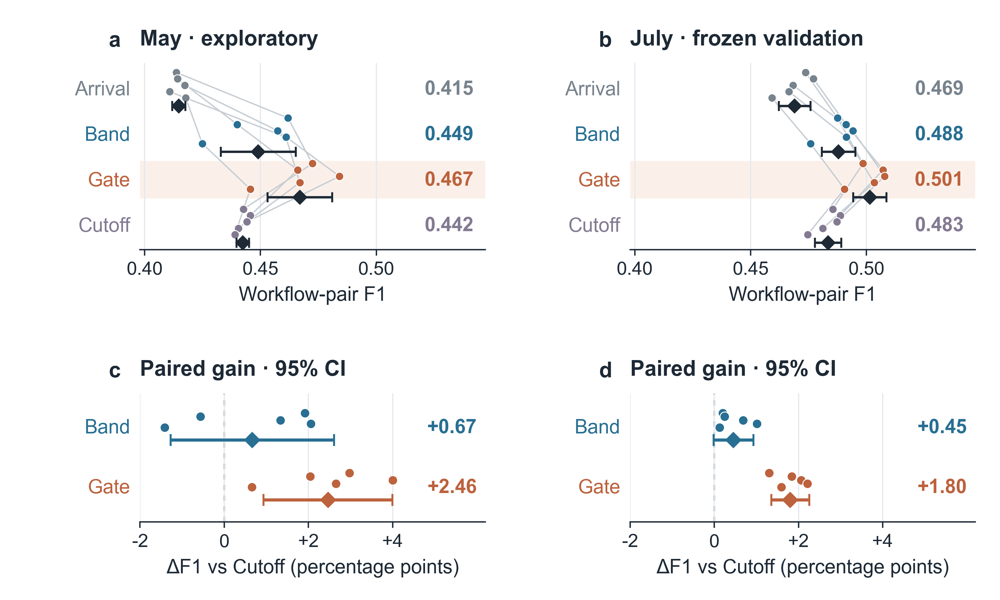
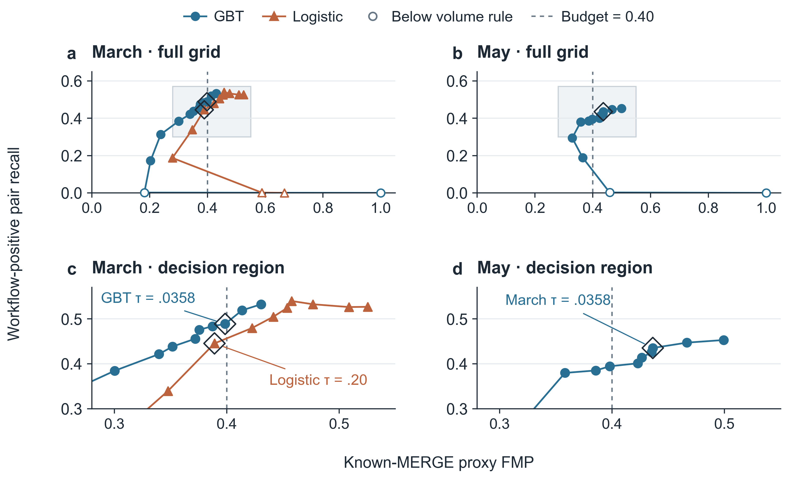
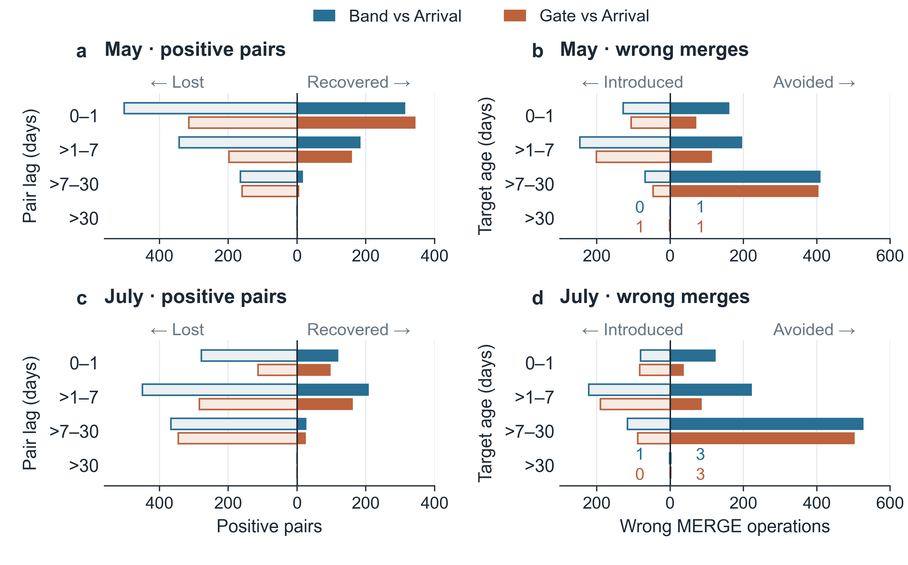

# Manuscript and illustrations

[Paper PDF](main.pdf) · [Figure 1 PNG](figures/fig0_concept.png) ·
[Figure 2 PNG](figures/fig1_workflow.png) ·
[LaTeX source ZIP](https://github.com/yyting2006-ai/deferral-streaming-linkage/releases/download/v0.2.6/pvldb_revision_source.zip)

The manuscript has 13 pages, five figures, seven tables and two algorithms.
The main text ends on page 12; references continue onto page 13. The 37 cited
works expand the incremental/progressive ER, learned matching, blocking,
evaluation and data-provenance coverage. See the [citation revision](citation_revision.md).
It includes a real-stream post-deadline prefix check, July hidden-Gate contrasts,
a resource summary, workflow-positive terminology and an explicit mapping to
the stable figure source filenames. The [supplement](../../reproductions/round2/README.md)
provides the corresponding evidence and reproduction commands.

Figure 1 on page 2 is an AI-assisted concept illustration of the selected
deferred path. Its [exact prompts](figures/fig0_concept.prompt.txt) and
[provenance](figures/fig0_concept.provenance.json) accompany the image; the caption
states its scope.

Figure 2 is a technical-roadmap schematic made with ImageGen. Four horizontal
stages cover the temporal protocol, shared inference, commitment and evaluation.
Three columns organize the study stage, research workflow, and checks and outputs.
The commitment paths distinguish a claim, which finalizes the pending target as
NEW, from seven-day re-scoring, which emits NEW or MERGE. Its
[exact prompt](figures/fig1_workflow.prompt.txt) and
[provenance](figures/fig1_workflow.provenance.json) record generation and internal
semantic review. Both illustrations are disclosed in their manuscript captions.
Figures 3–5 are code-generated empirical plots with released source data.
Version v0.2.6 uses 9.5–11 pt labels at 180 mm width, paired effect intervals,
full-grid risk curves with enlarged decision regions, and horizontal diverging
count plots. Original measurements are preserved. See the
[figure revision](data_figure_revision.md) and
[standalone plotting source/data ZIP](https://github.com/yyting2006-ai/deferral-streaming-linkage/releases/download/v0.2.6/data_figures_source.zip).

The earlier [structured workflow](../../reproductions/revision_v2/figures/fig1_workflow.png)
remains reproducible through `analysis.render_revision_figures --figures workflow`.

The public ZIP contains complete LaTeX compilation inputs, figures, tables,
prompts, bibliography, unmodified official template files and a checksum
manifest. An isolated build yields 13 pages with identical page text, zero
overfull boxes and zero undefined references. See [verification](source_package_verification.json)
and [download checksums](SHA256SUMS.txt).

Original experiment results and municipal input snapshots remain available in
[v0.2.0](https://github.com/yyting2006-ai/deferral-streaming-linkage/releases/tag/v0.2.0).
